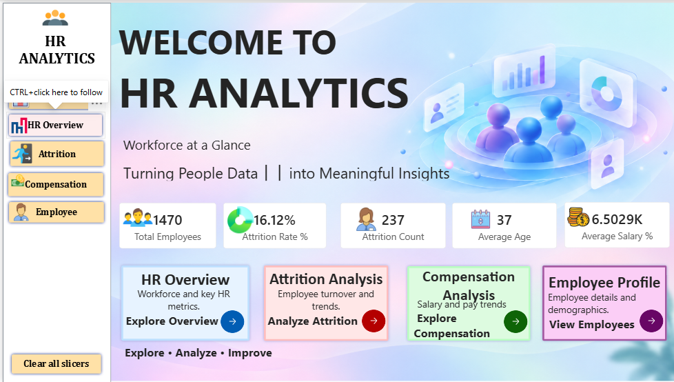
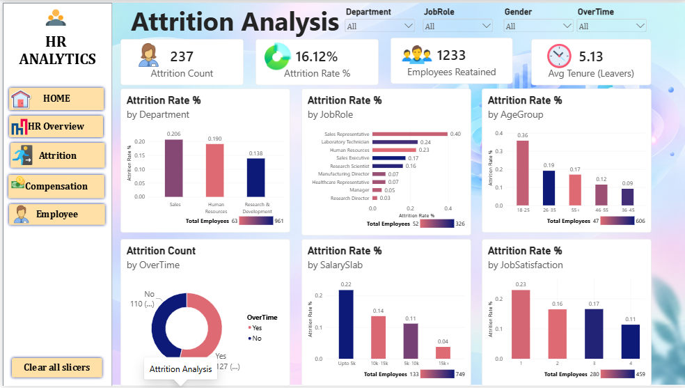
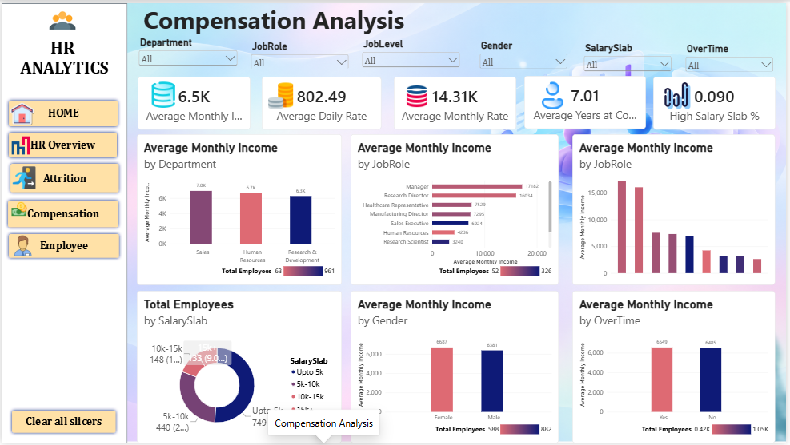
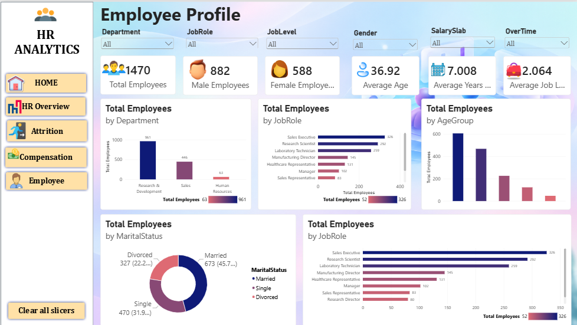

# HR Attrition Analysis | Power BI

An interactive Power BI report for exploring workforce composition, employee attrition, and compensation patterns using an HR analytics dataset.

> **Accuracy note:** Treat KPI totals and percentages as final only after checking them against the exact `HR_Analytics.csv` file and the final Power BI report. This README documents the project structure and analytical approach without presenting unverified figures as validated results.

## Table of Contents

- [Project Overview](#project-overview)
- [Business Objectives](#business-objectives)
- [Tools and Technologies](#tools-and-technologies)
- [Repository Structure](#repository-structure)
- [Dataset Overview](#dataset-overview)
- [Dashboard Pages](#dashboard-pages)
- [Dashboard Screenshots](#dashboard-screenshots)
- [KPIs and Definitions](#kpis-and-definitions)
- [Data Preparation and Derived Fields](#data-preparation-and-derived-fields)
- [Business Questions](#business-questions)
- [Validation Checklist](#validation-checklist)
- [Limitations](#limitations)
- [How to Open the Report](#how-to-open-the-report)
- [Privacy and Responsible Use](#privacy-and-responsible-use)

## Project Overview

The goal of this project is to organize HR data into an interactive report that helps users examine employee attrition, workforce characteristics, and compensation.

The report is organized into five pages:

1. Home
2. HR Overview
3. Attrition Analysis
4. Compensation Analysis
5. Employee Profile

The report supports descriptive analysis. Patterns and differences between employee groups can inform further investigation, but they do not by themselves establish why an employee left or prove that a particular factor caused attrition.

## Business Objectives

- Summarize the employee population represented by the source data.
- Measure attrition using a clearly defined count and rate.
- Explore differences in attrition across available workforce segments.
- Examine monthly income across relevant organizational categories where supported by the report.
- Explore workforce characteristics such as age, department, job role, and tenure where those fields exist.
- Provide a structured report for users who are authorized to access the data.
- Document KPI definitions and assumptions so report users can interpret results consistently.

## Tools and Technologies

| Tool / technology | Purpose |
|---|---|
| Microsoft Power BI Desktop | Report authoring, data modeling, measures, and visualizations |
| CSV | Source-data format |
| Power Query and/or DAX | Data preparation and calculations, depending on the implementation in the `.pbix` |

The exact Power BI version and which calculations are implemented in Power Query versus DAX should be documented only after checking the final project.

## Repository Structure

The repository is organized as follows:

```text
hr_attrition_analysis/
├── 01_Raw_Data/
│   └── HR_Analytics.csv
├── 02_PowerBI_Report/
│   └── hr_attrition_analysis.pbix
├── 03_Documentation/
│   └── HR_Analytics_Business_Documentation.docx
├── 04_Data_Dictionary/
│   └── HR_Analytics_Data_Dictionary.xlsx
├── 05_Assets/
│   ├── background/
│   ├── icon/
│   └── dashboard_image/
└── README.md
```

This tree reflects the structure provided for this project. The dashboard screenshot filenames and relative paths are listed in the Dashboard Screenshots section.

## Dataset Overview

| Item | Description |
|---|---|
| Source file | `01_Raw_Data/HR_Analytics.csv` |
| Data format | CSV |
| Intended grain | Employee-level records; confirm that each row represents one employee and that the employee key is unique |
| Subject areas | HR demographics, organizational information, compensation, and attrition, depending on the fields in the source |
| Historical analysis | The documented dataset does not have a verified historical date field suitable for time-series attrition analysis |

Before publishing specific dataset statistics, verify the row count, column count, employee identifier, missing values, and attrition totals directly from this exact CSV.

## Dataset Source and Attribution

The source dataset for this project was obtained from Kaggle.

**Kaggle dataset:** Add the exact dataset title used for this project.  
**Dataset URL:** Add the direct Kaggle dataset URL.  
**License / usage terms:** Check the license and dataset terms on the original Kaggle page before redistributing the CSV publicly.

The exact Kaggle dataset title, URL, and license have not been verified from the project files available for this README, so they are intentionally not guessed here. Confirm these details from the Kaggle page you downloaded the data from before publishing.

## Dashboard Pages

The report is documented as having five pages. The descriptions below explain the purpose of each page; make sure the final `.pbix` contains the corresponding pages and visuals.

### 1. Home

The report landing page. It introduces the report and provides navigation to the main analysis sections. Include only the KPIs and navigation controls present in the final report.

### 2. HR Overview

A high-level view of the workforce. Depending on the visuals in the final report, this page may summarize employee distribution across organizational or demographic categories and show headline workforce KPIs.

### 3. Attrition Analysis

A focused view of employees recorded as having left the organization. The intended attrition category is `Attrition = "Yes"`, if that is the exact field and value used in the source. Segment comparisons should be described only for fields and visuals actually present in the report.

### 4. Compensation Analysis

A view of compensation-related information. `MonthlyIncome` may be used for monthly-income analysis if that column exists in the model. Do not treat `DailyRate`, `HourlyRate`, `MonthlyRate`, and `MonthlyIncome` as interchangeable fields.

### 5. Employee Profile

An employee-level exploration page based on fields available in the model. Keep employee-level details restricted to authorized audiences, and do not publish screenshots containing identifiable or sensitive employee information.

## Dashboard Screenshots

The following images are stored in `05_Assets/dashboard_image/`:










## KPIs and Definitions

These are recommended definitions for documenting the report. Confirm that they match the measures implemented in the `.pbix`.

| KPI | Definition | Validation notes |
|---|---|---|
| Total Employees | Count of valid employee records, ideally using a verified unique employee identifier | Check that the identifier is populated and unique |
| Attrition Count | Count of employees whose attrition value is `Yes` | Check exact source values, whitespace, and blanks |
| Attrition Rate | Attrition Count divided by Total Employees in the same filter context | Verify the denominator and behavior under slicers |
| Average Monthly Income | Average of the `MonthlyIncome` field for the selected population | Confirm the field exists, is numeric, and has understood units |
| Average Age | Average of the `Age` field for the selected population | Confirm the field exists, is numeric, and missing values are handled consistently |

If the source includes a field such as `EmployeeCount`, do not automatically sum it to count employees. Use a verified unique identifier or establish the data grain first.

### Illustrative DAX patterns

The examples below are templates, not a claim that these exact measures are already in the report. Replace `'HR Data'` and field names with the actual model names.

```DAX
Total Employees =
DISTINCTCOUNT ( 'HR Data'[EmployeeID] )
```

```DAX
Attrition Count =
CALCULATE (
    [Total Employees],
    'HR Data'[Attrition] = "Yes"
)
```

```DAX
Attrition Rate =
DIVIDE ( [Attrition Count], [Total Employees], 0 )
```

Use these measures only after confirming the table and column names, employee key, attrition values, and intended filter behavior.

## Data Preparation and Derived Fields

The exact transformations should be described based on the Power Query steps and model logic in the final `.pbix`. The following checks are useful when applicable:

- Confirm column names and data types.
- Check missing values and duplicate records.
- Validate the employee identifier and record grain.
- Standardize categorical values where necessary and document any mappings.
- Check numeric fields for invalid or unexpected values.
- Reconcile attrition categories and counts.
- Verify any derived categories and their sort order.

If the model contains an `AgeGroup` field, document its exact non-overlapping boundaries and the treatment of blanks. If it contains a `SalarySlab` field, document the precise thresholds, boundary rules, and sorting. Do not infer the implemented logic from category labels alone.

## Business Questions

Depending on the fields and visuals available, the report can help investigate questions such as:

- How is the employee population distributed across departments and job roles?
- What are the attrition count and attrition rate for the selected population?
- How does attrition vary across available workforce segments?
- How does average monthly income differ across relevant organizational groups?
- How are employees distributed across age groups or salary bands, if these categories exist in the model?
- What information is available for an employee selected in the profile view?

These questions describe patterns and associations. Additional evidence and business context are needed before making causal claims or recommending interventions.

## Validation Checklist

Before presenting the report as complete, verify:

1. **Source file:** Power BI uses `01_Raw_Data/HR_Analytics.csv`.
2. **Data grain and keys:** Confirm the employee identifier is populated and unique, or document the actual grain.
3. **Attrition logic:** Reconcile `Yes`, `No`, blanks, and any unexpected categories.
4. **KPI results:** Independently verify key counts, rates, and averages against the same source population.
5. **Derived fields:** Test category boundaries, missing values, and sort order.
6. **Interactions:** Test slicers, cross-filtering, navigation, and page interactions.
7. **Refresh:** Confirm the report refreshes successfully from the intended source path.
8. **Documentation:** Check that screenshots, the business document, data dictionary, and README match the final report.
9. **Public repository safety:** Ensure no confidential data or sensitive screenshots are committed.

## Limitations

- **Historical trends:** Do not claim monthly or yearly attrition trends unless the source contains appropriate historical data.
- **Snapshot interpretation:** Results describe the records in the supplied dataset and should not automatically be presented as the organization's current workforce.
- **Association is not causation:** Differences in attrition between groups do not prove that a characteristic caused employees to leave.
- **Data-dependent metrics:** Totals, averages, and rates depend on the source file, cleaning rules, measure definitions, and report filter context.
- **Implementation details:** Exact transformations, measures, visual inventory, and refresh settings must be confirmed from the final `.pbix`.

## How to Open the Report

1. Install or open Microsoft Power BI Desktop.
2. Open `02_PowerBI_Report/hr_attrition_analysis.pbix`.
3. If Power BI cannot find the source, update the source path in Power Query to point to `01_Raw_Data/HR_Analytics.csv`.
4. Refresh the data and resolve any source or transformation errors.
5. Validate the core KPI values against the source data.
6. Test all five pages, filters, interactions, and navigation.
7. Save the report after confirming that it refreshes correctly.

The exact source-path adjustment depends on how the report was configured on the original machine.

## Documentation and Assets

- **Business documentation:** `03_Documentation/HR_Analytics_Business_Documentation.docx`
- **Data dictionary:** `04_Data_Dictionary/HR_Analytics_Data_Dictionary.xlsx`
- **Design and dashboard assets:** `05_Assets/`

Use the business documentation for the business context and the data dictionary for field-level definitions. Ensure both files describe the same dataset and model as the final report.

## Privacy and Responsible Use

HR datasets can contain personal or sensitive information. Before making this repository public:

- Confirm you have permission to redistribute the CSV and related assets.
- Do not publish confidential employee records or identifying information.
- Inspect dashboard images for employee-level details before committing them.
- Check the repository history if sensitive files were previously committed; deleting a file in a later commit does not remove it from Git history.
- Follow applicable data-protection requirements and organizational policies.

If you know the original dataset source and license, add the verified attribution here. Do not invent a source or license.

---

**Project:** HR Attrition Analysis  
**Primary tool:** Microsoft Power BI  
**Source file:** `01_Raw_Data/HR_Analytics.csv`
